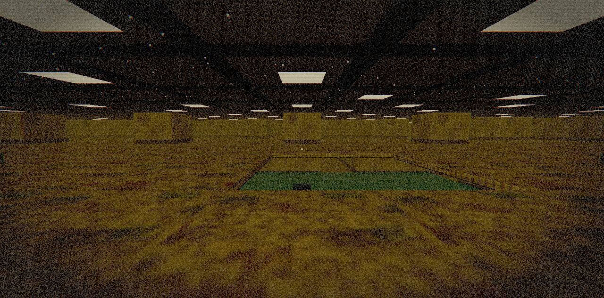
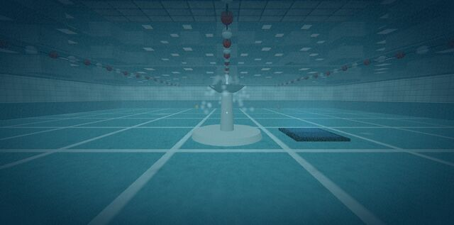
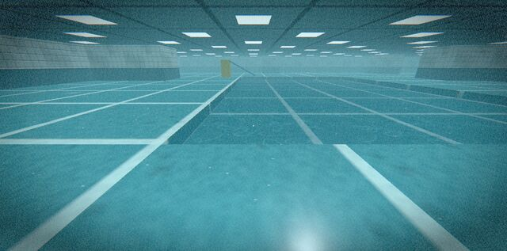
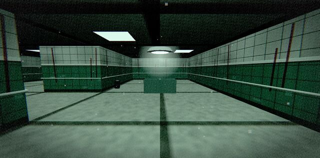
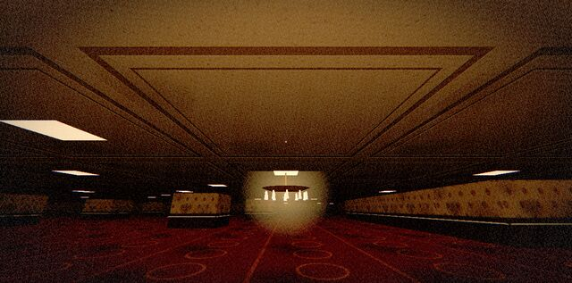
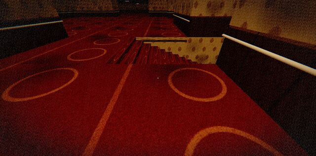
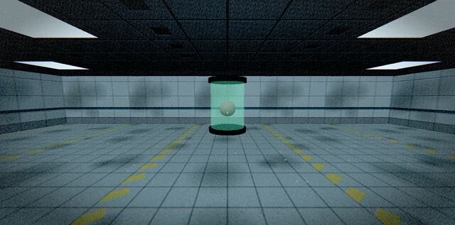
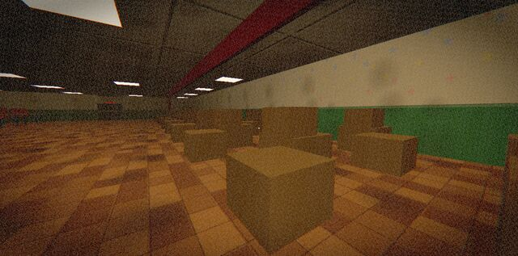
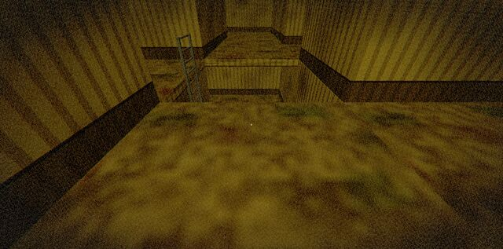
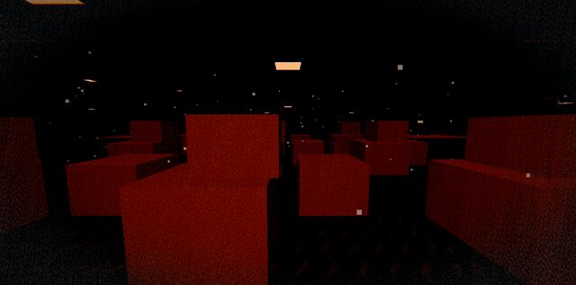

<div align="center">

# BACKROOMS: побег из Закулисья

**Кооперативный 3D-хоррор в браузере на 1–8 игроков по локальной сети**

11 уровней · многоэтажные локации · двойник, который крадёт облик друга · админ-панель хоста · без установки у друзей


[](LICENSE)



</div>

Вы проснулись в бесконечных жёлтых коридорах. Гудят лампы, пахнет мокрым ковром, где-то за стеной кто-то ходит.
Чтобы выбраться, нужно решить головоломку уровня, открыть дверь выхода и добежать до неё живыми.
Уровней одиннадцать, и с каждым становится хуже.

- **Каждый уровень — отдельное место**: бассейны с атриумом в четыре этажа, больница, отель с одинаковыми дверями, затопленный торговый центр, лаборатория, школа, где всё вдвое больше, и фабрика в финале.
- **Вертикальность**: лестницы, стремянки, провалы в полу, лазы, лифты, вода, в которой можно плавать и нырять.
- **У каждого уровня своё существо**: одно замирает под взглядом, другое слышит только бег, третье идёт на тепло фонаря.
- **Skin Stealer**: существо утаскивает отставшего и ходит среди вас под его ником. Кто из друзей настоящий?
- **Смерть — не конец**: погибший смотрит глазами живых, ставит им метки, а друзья могут его воскресить.
- **Карты генерируются заново** при каждом прохождении. Каждое прохождение не похоже на прошлое.

## Содержание

- [Быстрый старт](#быстрый-старт)
- [Как подключить друга](#как-подключить-друга)
- [Скриншоты](#скриншоты)
- [Управление](#управление)
- [Как играть](#как-играть)
- [Уровни](#уровни)
- [Особенности](#особенности)
- [Админ-панель хоста](#админ-панель-хоста)
- [Настройки и графика](#настройки-и-графика)
- [Параметры сервера](#параметры-сервера)
- [Для разработчиков](#для-разработчиков)

## Быстрый старт

Нужен только [Node.js](https://nodejs.org) (версия LTS), и только на компьютере, который будет сервером.

1. Скачайте проект: **Code → Download ZIP** (или `git clone https://github.com/Lilux12/backrooms-lan.git`) и распакуйте его.
2. Запустите сервер:
   - **Windows**: дважды кликните `start.bat`;
   - **Linux / macOS**: `./start.sh`.
3. Игра откроется в браузере по адресу `http://localhost:3000`. Введите ник и нажмите **ИГРАТЬ**.

`npm install` не нужен: у сервера нет зависимостей, а Three.js лежит в проекте. Интернет тоже не нужен.

## Как подключить друга

В окне сервера появятся адреса:

```
Сервер запущен. Играйте по адресам:
  Вы (на этом компьютере):  http://localhost:3000
  Друг (по локальной сети): http://192.168.1.42:3000
```

Отправьте другу адрес из строки «Друг (по локальной сети)». Он откроет его в браузере (Chrome, Edge или Firefox), ничего устанавливать не нужно.

| Проблема | Что сделать |
|---|---|
| Друг не может подключиться | При первом запуске Windows спросит про брандмауэр: разрешите Node.js доступ в **частных сетях** |
| Всё равно не подключается | Оба компьютера должны быть в одной сети (один роутер или Wi-Fi) |
| «Порт 3000 занят» | Запустите на другом порту: `set PORT=4000` (Windows) или `PORT=4000 ./start.sh` |
| Связь оборвалась | Клиент переподключится сам, сервер 2 минуты помнит игрока по нику: место и предметы сохранятся |

## Скриншоты

| | | |
|:---:|:---:|:---:|
|  |  |  |
| Бассейны: вышка в атриуме | Бассейны: 25-метровая дорожка | «Беги!»: больничный коридор |
|  |  |  |
| Отель: мраморный холл | Отель: лестничный пролёт | Лаборатория: камера с образцом |
|  |  |  |
| Детская: всё вдвое больше | Жёлтые комнаты: провал на этаж ниже | Фабрика: финал |

## Управление

<table>
<tr><td valign="top">

**Движение**

| Клавиша | Действие |
|---|---|
| W A S D | идти |
| Мышь | смотреть |
| Shift | бежать |
| Пробел | прыжок, в воде всплыть, на стремянке вверх |
| C | присесть, ползти по лазу, нырнуть |

**Предметы и мир**

| Клавиша | Действие |
|---|---|
| E | действие: рычаг, щиток, записка, терминал, лифт |
| F | фонарик (батарея садится) |
| N | камера ночного видения |
| R | аптечка: воскресить друга |
| B | бросить шумелку |

</td><td valign="top">

**Команда**

| Клавиша | Действие |
|---|---|
| Enter / T | чат |
| 1–4 | реплики: «Сюда!», «Бегите!», «Помогите!», «Тихо…» |
| Z / X | метки «сюда» / «опасность» |
| G | проверить игрока жестом |
| Y | спросить кодовое слово |
| V | детектор двойника |

**Интерфейс**

| Клавиша | Действие |
|---|---|
| M | карта (нужна улучшенная карта) |
| J | дневник: записки, кассеты, цели |
| H | скрыть миникарту |
| P | фоторежим |
| F3 | FPS и отладка |
| Esc | пауза (мир не ждёт), кнопка «Я застрял» |

</td></tr>
</table>

Клавиши переназначаются в настройках. Поддерживается **геймпад**: левый стик — ход, правый — взгляд, A — прыжок, B — присесть, X — действие, Y — фонарь, RB — бег, Back — карта.

## Как играть

**Цель уровня.** Решите головоломку (цели видны слева вверху), откройте дверь выхода и доберитесь до неё. Когда кто-то дошёл до двери, у остальных есть 8 секунд, чтобы успеть. Когда выход открывается, существа это чуют и бегут к двери.

**Вдвоём проще.** Во многих головоломках есть переключатели, которые работают, только пока на них стоят или держат E: рубильник, плиты, кнопки, насос. Один держит, другой проходит. Одному тоже можно, но придётся успеть добежать, пока лампа мигает.

**Свет и шум.** Фонарик помогает видеть, но существа замечают его издалека. Бег, вода и громкие реплики тоже слышны. Шумомер внизу экрана показывает, насколько вас слышно.

**Смерть и призраки.** Пойманный существом, утонувший или упавший с большой высоты игрок не выбывает, а становится призраком:
- смотрит глазами живых и переключается между ними (←/→, Q/E, ЛКМ/ПКМ);
- видит их выносливость, фонарь и пинг;
- пишет в чат и ставит на карте метки, которые живые видят мерцающими.

Вернуть друга можно **аптечкой** (R) или на **алтаре** (E). Если погибли все, появится экран со статистикой, и уровень начнётся заново.

<details>
<summary><b>Skin Stealer — как распознать двойника</b></summary>

На «Жёлтых комнатах» бродит существо, которое крадёт облик. Оно выслеживает отставшего, утаскивает его в клетку и ходит среди вас под его ником и с его фонариком. Сначала подмена почти незаметна, потом становится всё страннее: ник «сбоит», фонарь мигает невпопад, движения дёргаются, в чат приходят сообщения от чужого имени.

Как разоблачить:
- **жест** (G): настоящий игрок отвечает сразу, двойник отвечает с опозданием, неправильно или молчит;
- **кодовое слово** (Y): у каждого игрока своё слово (видно вверху экрана), двойник его не знает;
- **свет**: двойник не выдерживает прямого луча фонаря 2 секунды;
- **детектор** (V): пищит рядом с двойником, а сканирование срывает маску;
- **чат**: настоящий игрок пишет из клетки. Освободите его (E на клетке), и двойник тоже будет разоблачён.

Разоблачённого двойника ослепляет фонарь, а шумелка (B) отвлекает. Если вы играете один, двойник «зайдёт в игру» как ещё один игрок.

</details>

**Улучшенная карта.** На Жёлтых комнатах (и реже на Парковке) лежит светящаяся синяя карта. Её подбирает кто-то один, но улучшение действует на всю команду до конца игры: миникарта видит дальше, а на ней и на большой карте (M) видны существа.

**Бутылки воды** восстанавливают выносливость. **Шкафчики** (E) прячут от существ, если существо не видело, как вы залезли.

## Уровни

| # | Уровень | Что это за место | Кто там живёт |
|:-:|---|---|---|
| 0 | **Жёлтые комнаты** | Классический жёлтый лабиринт, Великий зал с колоннами, провал на нижний этаж с мокрым ковром | Сталкер и **Skin Stealer** |
| 1 | **Подземная парковка** | 3 яруса, спиральные пандусы, будка охраны, затопленный нижний ярус | **Фары**: видят только перед собой, идут на вой сигнализации |
| 2 | **Технические тоннели** | Шахта на три яруса, мостки над пропастью, котельная, лазы | **Червь** в трубах: вылезает, если бежать |
| 3 | **Бассейны** | Атриум в 4 этажа с водой, ленивая река, сауны, насосная | **Утопленник** хватает тех, кто в воде |
| 4 | **Беги!** | Больница: коридоры змейкой, палаты-срезки, морг, падающие каталки | Стая **Улыбающихся**, которая режет путь |
| 5 | **Офисы** | Open space на 3 этажа, атриум, серверная с камерами | Сталкер и **Ползун** в вентиляции |
| 6 | **Бесконечный отель** | Мраморный холл, 56 одинаковых дверей, номера меняются, пока не смотришь | **Коридорный**: замирает под взглядом |
| 7 | **Затопленный торговый центр** | Эскалаторы, фудкорт, кинотеатр, первый этаж по пояс в воде | **Манекены**: двигаются в темноте |
| 8 | **Заброшенная лаборатория** | Шлюзы, карантин, реакторный зал через все этажи | **Образец**: идёт на тепло фонаря и мутирует |
| 9 | **Детская** | Школа, где всё вдвое больше, лабиринт из коробок, актовый зал | **Воспитательница** засыпает под музыкальную шкатулку |
| 10 | **Фабрика** | 5 ярусов печей, конвейеров и шестерёнок под чёрным небом. Две концовки | **Надсмотрщик** и призраки прошлых уровней |

Пройденные уровни открываются в меню, и хост может запустить любой из них. После финала кампания начинается заново с новыми картами.

<details>
<summary><b>Головоломки уровней (спойлеры)</b></summary>

| # | Уровень | Головоломка |
|:-:|---|---|
| 0 | Жёлтые комнаты | 3 **предохранителя** (один внизу, за провалом) → **щиток** → он работает, только пока кто-то **держит рубильник** |
| 1 | Подземная парковка | 4 цифры кода на разных ярусах **видны только в свете фонаря**. Терминал работает, пока запущен **генератор**. В будке **рация** с подсказками охранника-призрака и **камеры** |
| 2 | Технические тоннели | **Вентиль** в котельной даёт давление пара → **две плиты на разных ярусах** → **паровой шлюз** открыт, пока нажаты обе |
| 3 | Бассейны | Вентили по таблице давления и **слив** → **задвижка** на дне (держится 7 с) → **ключ-карта** → **насос** поднимает воду к выходу |
| 4 | Беги! | Дверь открыта сразу. Палаты срезают путь, но **двери захлопываются**, а о мебель на бегу **спотыкаешься** |
| 5 | Офисы | 2 **предохранителя** → **код** → терминал в **переговорной**, её дверь открывается **кнопкой на ресепшене**, пока кто-то держит |
| 6 | Бесконечный отель | **Книга регистрации** с загадками → **4 ключа** в номерах → **ключница** → кнопки **служебного лифта** на двух этажах **одновременно** → крыша |
| 7 | Торговый центр | **Канистра** и **предохранитель** → **генератор** на крыше работает, пока кто-то **качает насос** → **код** от решётки кино на двух **кассетах** камер |
| 8 | Лаборатория | **Допуски** синий → жёлтый → красный → **охладитель** из трёх реагентов → **два ключа** у ядра разом → **100 секунд**, чтобы подняться к люку |
| 9 | Детская | 6 **кусочков картины** → **считалочка**: игрушки на нужные полки → **двое качелей** одновременно |
| 10 | Фабрика | **4 печи** по температуре → **паропроводы** → **2 конвейера** разом → **3 консоли** разом. Выйти к небу или сесть в **кресло Надсмотрщика** |

Если 5 минут нет прогресса, на карте появляется метка у следующего шага.

</details>

## Особенности

| | |
|---|---|
| **«Режиссёр»** | Следит за напряжением команды. Если долго тихо, устраивает событие: шёпот за спиной, шаги, мигание света, лицо в обоях, звонок телефона. Если слишком долго страшно, даёт передышку |
| **Сложность** | **Лёгкая**: поимка не убивает. **Нормальная**: есть аптечки и алтарь. **Хардкор**: одна жизнь на уровень. Чем больше игроков, тем быстрее существа |
| **Модификаторы раунда** | С шансом 40% уровень получает правило: свет вполсилы, быстрые существа, без миникарты, густой туман, нет воды… |
| **Роли** | Разведчик (быстрее, миникарта шире), Механик (переключатели держатся дольше), Медик (аптечка на каждом уровне) |
| **Ежедневный сид** | У всех сегодня одни и те же карты, можно сравнить время с друзьями |
| **Рекорды и достижения** | Лучшее время каждого уровня и всей кампании, 14 достижений, включая обе концовки |
| **Фоторежим** | P прячет HUD и рисует кадр с названием уровня и датой, Enter сохраняет снимок |
| **Пасхалки** | Номер 237 в отеле, 4813-я лампа в Жёлтых комнатах и ещё кое-что |

## Админ-панель хоста

При запуске сервер печатает ссылку вида `http://localhost:3000/#admin=ТОКЕН`. Откройте её у себя, и вы станете хостом. Панель открывается клавишей **F1** (или **~**).

<details>
<summary><b>Что умеет панель</b></summary>

- **Игроки**: телепорт к игроку и игрока к себе, кик и бан, оживить и убить, бессмертие, невидимость для существ, скорость, прыжок, полёт, прохождение сквозь стены, размер, облик (утка, куб, банан), цвет, выдать предметы, заморозка.
- **Мир**: уровень и seed, перезапуск, пропуск, открыть выход, решить головоломку, телепорт кликом по карте, свет, мерцание, сирена, туман, гравитация, скорость времени, дождь из предметов, затопление, дискотека, инверсия управления, фильтры (8-бит, ч/б, ночное зрение, VHS), свободная камера для призраков, сложность.
- **Существа**: призвать любое (в том числе Skin Stealer), убрать всех, скорость, всех в погоню, оглушить, сделать дружелюбными, клонировать, босс, отключить ИИ, сменить облик.
- **Развлечения**: фейерверк, конфетти, взрыв, батут, телепорт-ловушка, «пол — это лава», догонялки, прятки, свои правила раунда.

Команды в чате: `/tp /goto /give /spawn /kill /god /time /level /seed /speed /noclip /say /fly /size /skin /freeze /gravity /weather /lights /disco /lava /revive /kick /ban /help`.

Права проверяются только на сервере: без токена ни одна команда не выполнится, даже если подделать сообщение. Частота команд ограничена, перебор токена блокируется. Каждое действие хоста видят все игроки («Хост включил дискотеку»).

</details>

## Настройки и графика

- **Пресеты качества**: Низкое, Среднее, Высокое, Ультра. Каждый эффект включается отдельно: bloom, тени от фонаря, PBR-материалы, виньетка, хроматическая аберрация, зерно плёнки, VHS.
- **Динамическое разрешение**: если FPS падает ниже 45, разрешение снижается, а потом возвращается.
- **Звук полностью процедурный и трёхмерный**: слышно, откуда идёт опасность. Эхо зависит от помещения, шаги звучат по-разному на ковре, плитке, металле и в воде. Есть музыка напряжения в погоне.
- **Субтитры** звуков с направлением («[вой автосигнализации (слева)]»).
- **Подсказки новичку** показываются по одному разу и отключаются в настройках.

## Параметры сервера

Задаются переменными окружения перед запуском: `set ИМЯ=значение` в Windows или `ИМЯ=значение ./start.sh` в Linux/macOS.

| Переменная | По умолчанию | Что делает |
|---|---|---|
| `PORT` | `3000` | порт сервера |
| `MAX_PLAYERS` | `8` | сколько игроков пускать |
| `DIFFICULTY` | `normal` | сложность: `easy`, `normal`, `hard` |
| `DAILY` | выкл. | `1` — ежедневный сид (одинаковые карты у всех) |
| `START_LEVEL` | `0` | с какого уровня начать (0–10) |

Отладочные переменные описаны в [документации для разработчиков](docs/DEVELOPMENT.md#переменные-окружения-для-отладки).

## Для разработчиков

Сервер написан на чистом Node.js без зависимостей, включая собственную реализацию WebSocket. Клиент — ES-модули на Three.js без сборки. Генерация карт детерминирована: клиент и сервер строят одну и ту же карту из seed.

```
client/   браузерная часть: рендер, звук, интерфейс, ввод
server/   авторитетный сервер: уровни, головоломки, ИИ существ, режиссёр, админка
shared/   общий код: генераторы уровней, физика, навигация
tests/    автотесты: проходимость 300 seed, боты, браузерные тесты
docs/     документация и скриншоты
```

```
npm test          # все тесты
npm run verify    # проходимость каждого уровня на 300 seed
```

В **[docs/DEVELOPMENT.md](docs/DEVELOPMENT.md)** описаны структура кода, схема уровня, а также то, как добавить свой уровень, головоломку или существо и что проверяет каждый тест.

## Лицензия

[MIT](LICENSE)
