<div align="center">

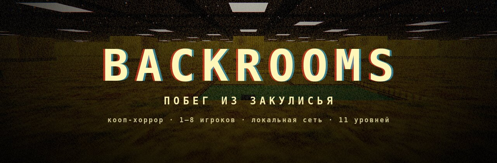

<br>


<a href="LICENSE"></a>

**[Быстрый старт](#-быстрый-старт)** · **[Уровни](#-уровни)** · **[Управление](#-управление)** · **[Как играть](#-как-играть)** · **[Для разработчиков](docs/DEVELOPMENT.md)**

<br>

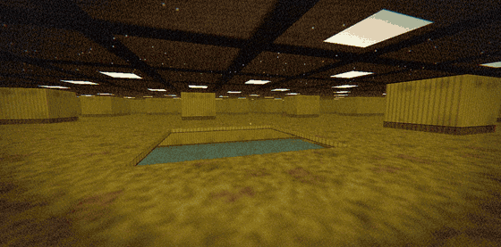

</div>

<br>

> *Если вы нечаянно провалитесь сквозь реальность, то окажетесь в Закулисье: бесконечные жёлтые коридоры, гул ламп
> и запах мокрого ковра. Вы здесь не одни. И то, что ходит рядом, не всегда тот, за кого себя выдаёт.*

**Backrooms** — кооперативный 3D-хоррор, который работает прямо в браузере. Один компьютер запускает сервер,
остальные просто открывают ссылку. Вместе ищите путь наружу через 11 уровней Закулисья, решайте головоломки,
которые не пройти без напарника, и не отставайте от своих.

<table>
<tr>
<td width="50%" valign="top">

### 🏚️ Место, а не лабиринт
Каждый уровень — отдельная локация на несколько этажей: атриум с бассейном, больница, отель с одинаковыми
дверями, торговый центр по пояс в воде, реактор, фабрика под чёрным небом. Лестницы, провалы, лазы, лифты, вода.

</td>
<td width="50%" valign="top">

### 👁️ Своё существо на каждом уровне
Одно замирает, пока на него смотрят. Другое слышит только бег. Третье идёт на тепло фонаря.
Четвёртое живёт в воде. Выживание зависит от того, поймёте ли вы правила.

</td>
</tr>
<tr>
<td valign="top">

### 🎭 Skin Stealer
Существо утаскивает отставшего и возвращается к вам в его облике: тот же ник, тот же фонарик.
Проверьте друга жестом, кодовым словом или светом, пока не поздно.

</td>
<td valign="top">

### 🤝 Кооператив по-настоящему
Один держит рубильник, другой бежит к двери. Погибший становится призраком, видит глазами живых
и ставит им метки, а друзья могут его воскресить.

</td>
</tr>
<tr>
<td valign="top">

### 🎬 «Режиссёр»
Следит за напряжением. Слишком тихо — шёпот за спиной, лицо в обоях, звонок в пустом коридоре.
Слишком страшно — даёт перевести дух.

</td>
<td valign="top">

### 🛠️ Админ-панель хоста
Дискотека, «пол — это лава», утки вместо существ, батуты, прятки. Хост управляет миром через панель (F1)
или команды чата.

</td>
</tr>
</table>

## 🚀 Быстрый старт

Нужен только [Node.js](https://nodejs.org) (версия LTS), и только на компьютере, который будет сервером.

```bash
git clone https://github.com/Lilux12/backrooms-lan.git   # или Code → Download ZIP
cd backrooms-lan
./start.sh                                               # Windows: дважды кликните start.bat
```

Игра откроется в браузере по адресу `http://localhost:3000`. Введите ник и нажмите **ИГРАТЬ**.
`npm install` не нужен: у сервера нет зависимостей, а Three.js лежит в проекте.

### Как позвать друга

В окне сервера появится адрес для друга:

```
Сервер запущен. Играйте по адресам:
  Вы (на этом компьютере):  http://localhost:3000
  Друг (по локальной сети): http://192.168.1.42:3000
```

Друг открывает его в браузере (Chrome, Edge или Firefox), ничего устанавливать не нужно.

<details>
<summary><b>Друг не может подключиться?</b></summary>

| Проблема | Что сделать |
|---|---|
| Не подключается совсем | При первом запуске Windows спросит про брандмауэр: разрешите Node.js доступ в **частных сетях** |
| Всё равно не подключается | Оба компьютера должны быть в одной сети (один роутер или Wi-Fi) |
| «Порт 3000 занят» | Запустите на другом порту: `set PORT=4000` (Windows) или `PORT=4000 ./start.sh` |
| Связь оборвалась | Клиент переподключится сам, сервер 2 минуты помнит игрока по нику: место и предметы сохранятся |

</details>

<table>
<tr>
<td width="50%">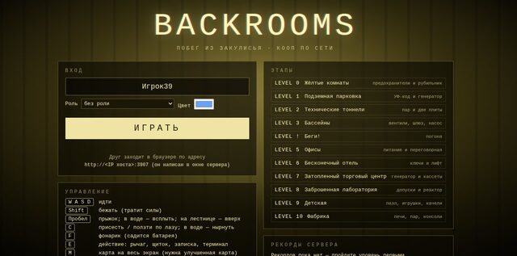</td>
<td width="50%">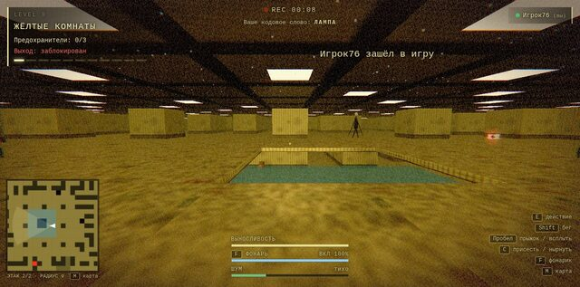</td>
</tr>
<tr>
<td align="center"><sub>Меню: роль, цвет, этапы, рекорды</sub></td>
<td align="center"><sub>В игре: цели, миникарта, выносливость, фонарь, шумомер</sub></td>
</tr>
</table>

## 🗺️ Уровни

<table>
<tr>
<td width="33%" valign="top">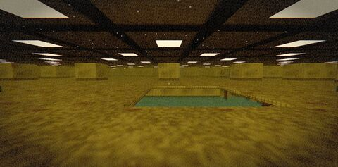<br><b>0 · Жёлтые комнаты</b><br><sub>Бесконечный жёлтый лабиринт, Великий зал с колоннами и провал на этаж с мокрым ковром.<br>👁️ Сталкер и <b>Skin Stealer</b></sub></td>
<td width="33%" valign="top">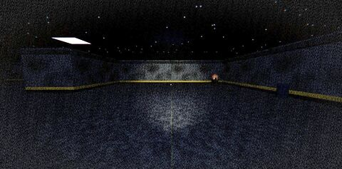<br><b>1 · Подземная парковка</b><br><sub>Три яруса, спиральные пандусы, будка охраны, затопленный нижний ярус.<br>👁️ <b>Фары</b>: видят только перед собой, идут на вой сигнализации</sub></td>
<td width="33%" valign="top">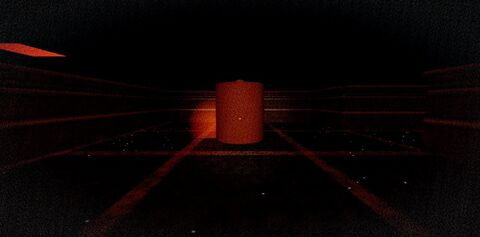<br><b>2 · Технические тоннели</b><br><sub>Шахта на три яруса, мостки над пропастью, котельная, пар и лазы.<br>👁️ <b>Червь</b> в трубах: вылезает, если бежать</sub></td>
</tr>
<tr>
<td valign="top">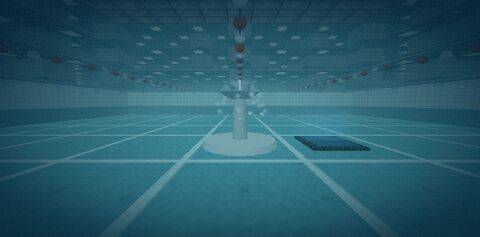<br><b>3 · Бассейны</b><br><sub>Атриум в четыре этажа с водой, вышки, ленивая река, сауны, насосная.<br>👁️ <b>Утопленник</b> хватает тех, кто в воде</sub></td>
<td valign="top">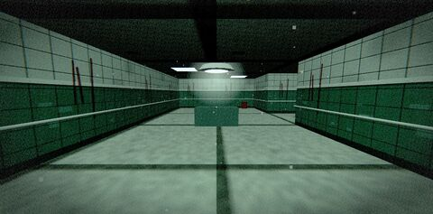<br><b>! · Беги!</b><br><sub>Больница: коридоры змейкой, палаты-срезки, морг, падающие каталки.<br>👁️ Стая <b>Улыбающихся</b>, которая режет путь</sub></td>
<td valign="top">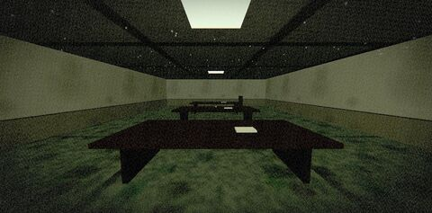<br><b>5 · Офисы</b><br><sub>Open space на три этажа, стеклянная переговорная, серверная с камерами.<br>👁️ Сталкер и <b>Ползун</b> в вентиляции</sub></td>
</tr>
<tr>
<td valign="top">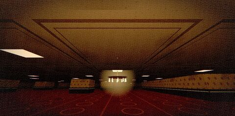<br><b>6 · Бесконечный отель</b><br><sub>Мраморный холл с люстрами и 56 одинаковых дверей. Номера меняются, пока вы не смотрите.<br>👁️ <b>Коридорный</b>: замирает под взглядом</sub></td>
<td valign="top">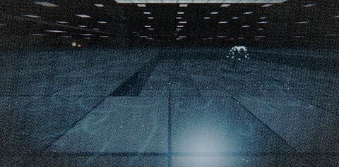<br><b>7 · Затопленный торговый центр</b><br><sub>Эскалаторы, фудкорт, кинотеатр, первый этаж по пояс в воде.<br>👁️ <b>Манекены</b>: двигаются в темноте</sub></td>
<td valign="top">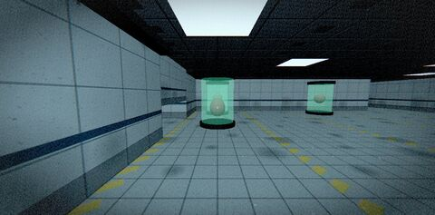<br><b>8 · Заброшенная лаборатория</b><br><sub>Шлюзы, карантин, камеры с образцами, реакторный зал через все этажи.<br>👁️ <b>Образец</b>: идёт на тепло фонаря и мутирует</sub></td>
</tr>
<tr>
<td valign="top">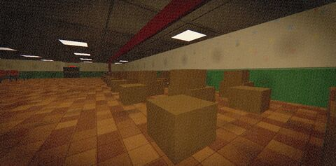<br><b>9 · Детская</b><br><sub>Школа, где всё вдвое больше, лабиринт из коробок, актовый зал со сценой.<br>👁️ <b>Воспитательница</b> засыпает под музыкальную шкатулку</sub></td>
<td valign="top">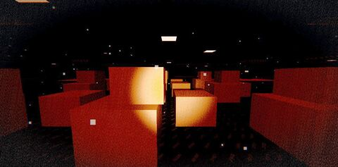<br><b>10 · Фабрика</b><br><sub>Пять ярусов печей, конвейеров и шестерёнок. Финал кампании и две концовки.<br>👁️ <b>Надсмотрщик</b> и призраки прошлых уровней</sub></td>
<td valign="middle" align="center"><sub>Карты строятся заново<br>при каждом прохождении.<br><br>Пройденные уровни<br>открываются в меню.</sub></td>
</tr>
</table>

<details>
<summary><b>🧩 Головоломки уровней (спойлеры)</b></summary>

| # | Уровень | Головоломка |
|:-:|---|---|
| 0 | Жёлтые комнаты | 3 **предохранителя** (один внизу, за провалом) → **щиток** → он работает, только пока кто-то **держит рубильник** |
| 1 | Подземная парковка | 4 цифры кода на разных ярусах **видны только в свете фонаря**. Терминал работает, пока запущен **генератор**. В будке **рация** с подсказками охранника-призрака и **камеры** |
| 2 | Технические тоннели | **Вентиль** в котельной даёт давление пара → **две плиты на разных ярусах** → **паровой шлюз** открыт, пока нажаты обе |
| 3 | Бассейны | Вентили по таблице давления и **слив** → **задвижка** на дне (держится 7 с) → **ключ-карта** → **насос** поднимает воду к выходу |
| ! | Беги! | Дверь открыта сразу. Палаты срезают путь, но **двери захлопываются**, а о мебель на бегу **спотыкаешься** |
| 5 | Офисы | 2 **предохранителя** → **код** → терминал в **переговорной**, её дверь открывается **кнопкой на ресепшене**, пока кто-то держит |
| 6 | Бесконечный отель | **Книга регистрации** с загадками → **4 ключа** в номерах → **ключница** → кнопки **служебного лифта** на двух этажах **одновременно** → крыша |
| 7 | Торговый центр | **Канистра** и **предохранитель** → **генератор** на крыше работает, пока кто-то **качает насос** → **код** от решётки кино на двух **кассетах** камер |
| 8 | Лаборатория | **Допуски** синий → жёлтый → красный → **охладитель** из трёх реагентов → **два ключа** у ядра разом → **100 секунд**, чтобы подняться к люку |
| 9 | Детская | 6 **кусочков картины** → **считалочка**: игрушки на нужные полки → **двое качелей** одновременно |
| 10 | Фабрика | **4 печи** по температуре → **паропроводы** → **2 конвейера** разом → **3 консоли** разом. Выйти к небу или сесть в **кресло Надсмотрщика** |

Если 5 минут нет прогресса, на карте появляется метка у следующего шага.

</details>

## 🎮 Управление

<table>
<tr><td valign="top">

| Движение | |
|---|---|
| <kbd>W</kbd> <kbd>A</kbd> <kbd>S</kbd> <kbd>D</kbd> | идти |
| <kbd>Shift</kbd> | бежать |
| <kbd>Пробел</kbd> | прыжок, всплыть, вверх по стремянке |
| <kbd>C</kbd> | присесть, ползти, нырнуть |

| Мир | |
|---|---|
| <kbd>E</kbd> | действие |
| <kbd>F</kbd> | фонарик |
| <kbd>N</kbd> | камера ночного видения |
| <kbd>R</kbd> | аптечка: воскресить друга |
| <kbd>B</kbd> | бросить шумелку |

</td><td valign="top">

| Команда | |
|---|---|
| <kbd>Enter</kbd> / <kbd>T</kbd> | чат |
| <kbd>1</kbd>–<kbd>4</kbd> | «Сюда!», «Бегите!», «Помогите!», «Тихо…» |
| <kbd>Z</kbd> / <kbd>X</kbd> | метка «сюда» / «опасность» |
| <kbd>G</kbd> | проверить игрока жестом |
| <kbd>Y</kbd> | спросить кодовое слово |
| <kbd>V</kbd> | детектор двойника |

</td><td valign="top">

| Интерфейс | |
|---|---|
| <kbd>M</kbd> | карта |
| <kbd>J</kbd> | дневник |
| <kbd>H</kbd> | скрыть миникарту |
| <kbd>P</kbd> | фоторежим |
| <kbd>F3</kbd> | FPS |
| <kbd>F1</kbd> | админ-панель (хост) |
| <kbd>Esc</kbd> | пауза |

</td></tr>
</table>

Клавиши переназначаются в настройках. 🎮 Есть поддержка **геймпада**: стики — ход и взгляд, A — прыжок, B — присесть, X — действие, Y — фонарь, RB — бег, Back — карта.

## 📖 Как играть

**Цель уровня.** Решите головоломку (цели видны слева вверху), откройте дверь выхода и доберитесь до неё.
Когда кто-то дошёл до двери, у остальных есть 8 секунд, чтобы успеть. Существа чуют открытый выход и бегут туда же.

**Один держит, другой бежит.** Рубильники, плиты, кнопки и насосы работают, только пока на них стоят или держат E,
и ещё несколько секунд после. Вдвоём легко. Одному придётся успеть добежать, пока мигает лампа.

**Свет и шум.** Фонарик помогает видеть, но существа замечают его издалека. Бег, вода и громкие реплики тоже слышны.
Шумомер внизу экрана показывает, насколько вас слышно. От существа можно спрятаться в **шкафчике** (E),
если оно не видело, как вы туда залезли.

**Смерть — не конец.** Погибший становится призраком: смотрит глазами живых (←/→, Q/E), видит их выносливость
и фонарь, пишет в чат и ставит метки на карте. Вернуть друга можно **аптечкой** (R) или на **алтаре** (E).
Если погибли все, уровень начнётся заново.

<details>
<summary><b>🎭 Как распознать двойника</b></summary>

На «Жёлтых комнатах» бродит Skin Stealer. Он выслеживает отставшего, утаскивает его в клетку и ходит среди вас
под его ником и с его фонариком. Сначала подмена почти незаметна, потом становится всё страннее: ник «сбоит»,
фонарь мигает невпопад, движения дёргаются.

| Способ | Как работает |
|---|---|
| Жест (<kbd>G</kbd>) | Настоящий игрок отвечает сразу, двойник — с опозданием, неправильно или молчит |
| Кодовое слово (<kbd>Y</kbd>) | У каждого игрока своё слово (видно вверху экрана), двойник его не знает |
| Свет | Двойник не выдерживает прямого луча фонаря 2 секунды |
| Детектор (<kbd>V</kbd>) | Пищит рядом с двойником, сканирование срывает маску |
| Чат | Настоящий игрок пишет из клетки. Освободите его (E на клетке), и двойник разоблачён |

Если вы играете один, двойник «зайдёт в игру» как ещё один игрок.

</details>

<details>
<summary><b>✨ Ещё фишки</b></summary>

| | |
|---|---|
| **Сложность** | **Лёгкая**: поимка не убивает. **Нормальная**: есть аптечки и алтарь. **Хардкор**: одна жизнь на уровень |
| **Модификаторы раунда** | С шансом 40% уровень получает правило: свет вполсилы, быстрые существа, без миникарты, густой туман… |
| **Роли** | Разведчик (быстрее, миникарта шире), Механик (переключатели держатся дольше), Медик (аптечка на каждом уровне) |
| **Улучшенная карта** | Лежит на первых уровнях. Кто-то один подобрал, и вся команда видит существ на карте |
| **Ежедневный сид** | У всех сегодня одни и те же карты: сравнивайте время с друзьями |
| **Рекорды и достижения** | Лучшее время каждого уровня и всей кампании, 14 достижений, включая обе концовки |
| **Фоторежим** | <kbd>P</kbd> прячет интерфейс и рисует кадр с названием уровня и датой |
| **Пасхалки** | Номер 237 в отеле, 4813-я лампа в Жёлтых комнатах и ещё кое-что |

</details>

<details>
<summary><b>🛠️ Админ-панель хоста</b></summary>

При запуске сервер печатает ссылку вида `http://localhost:3000/#admin=ТОКЕН`. Откройте её у себя, и вы станете хостом.
Панель открывается клавишей <kbd>F1</kbd> (или <kbd>~</kbd>).

- **Игроки**: телепорт, кик и бан, оживить, бессмертие, невидимость для существ, скорость, полёт, сквозь стены, размер, облик (утка, куб, банан), выдать предметы, заморозка.
- **Мир**: уровень и seed, пропуск, открыть выход, решить головоломку, свет, сирена, туман, гравитация, скорость времени, затопление, дискотека, фильтры (8-бит, ч/б, ночное зрение, VHS), сложность.
- **Существа**: призвать любое (в том числе Skin Stealer), убрать всех, оглушить, сделать дружелюбными, клонировать, босс, отключить ИИ.
- **Развлечения**: фейерверк, конфетти, взрыв, батут, телепорт-ловушка, «пол — это лава», догонялки, прятки.

Команды в чате: `/tp /goto /give /spawn /kill /god /time /level /seed /speed /noclip /say /fly /size /skin /freeze /gravity /weather /lights /disco /lava /revive /kick /ban /help`.

Права проверяются только на сервере: без токена ни одна команда не выполнится. Каждое действие хоста видят все игроки.

</details>

## ⚙️ Настройки и параметры

**Графика:** пресеты Низкое, Среднее, Высокое и Ультра; каждый эффект (bloom, тени от фонаря, PBR, виньетка,
зерно плёнки, VHS) включается отдельно. Если FPS падает ниже 45, разрешение снижается само.
**Звук** полностью процедурный и трёхмерный, с эхом по типу помещения и субтитрами с направлением звука.

Параметры сервера задаются переменными окружения: `set ИМЯ=значение` в Windows или `ИМЯ=значение ./start.sh` в Linux/macOS.

| Переменная | По умолчанию | Что делает |
|---|---|---|
| `PORT` | `3000` | порт сервера |
| `MAX_PLAYERS` | `8` | сколько игроков пускать |
| `DIFFICULTY` | `normal` | сложность: `easy`, `normal`, `hard` |
| `DAILY` | выкл. | `1` — ежедневный сид (одинаковые карты у всех) |
| `START_LEVEL` | `0` | с какого уровня начать (0–10) |

## 👩‍💻 Для разработчиков

Сервер написан на чистом Node.js без зависимостей, включая собственную реализацию WebSocket.
Клиент — ES-модули на Three.js без сборки. Карты детерминированы: клиент и сервер строят одну и ту же карту из seed.

```
client/   браузер: рендер, звук, интерфейс, ввод
server/   авторитетный сервер: уровни, головоломки, ИИ, режиссёр, админка
shared/   общий код: генераторы уровней, физика, навигация
tests/    автотесты: проходимость 300 seed, боты, браузерные тесты
```

```bash
npm test          # все тесты
npm run verify    # проходимость каждого уровня на 300 seed
```

Структура кода, схема уровня, как добавить свой уровень, головоломку или существо — в **[docs/DEVELOPMENT.md](docs/DEVELOPMENT.md)**.

<br>

<div align="center">
<sub>Сделано с процедурной графикой и звуком: ни одной текстуры и ни одного аудиофайла. · <a href="LICENSE">MIT</a></sub>
</div>
